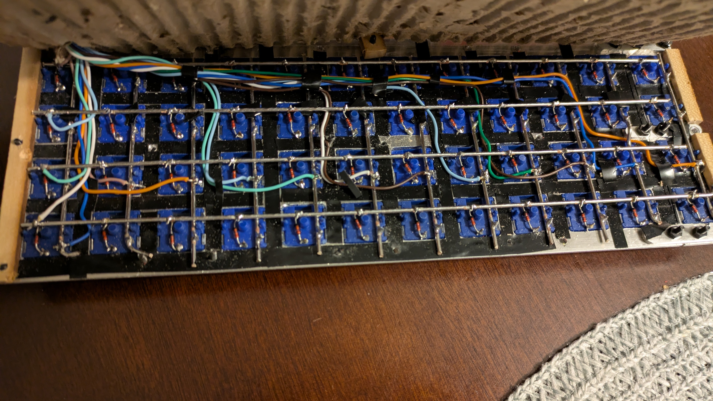
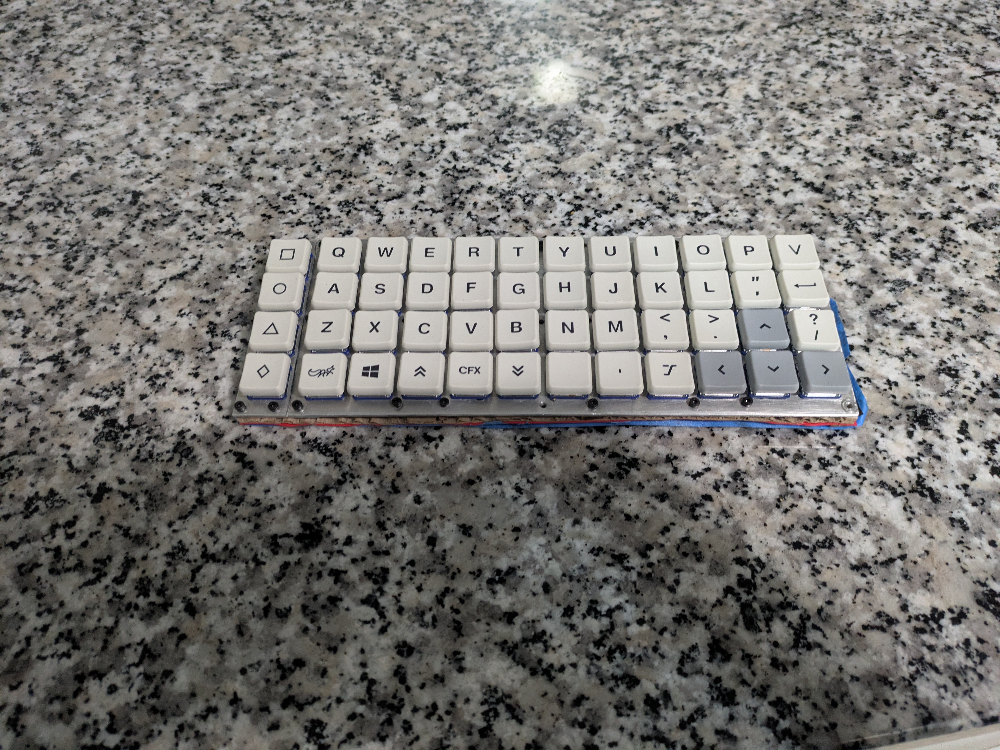

Included in this repository are the firmware files used for the final compilation of the Keyboard project.
The firmware is built on basis of the open-source ZMK keyboard project
The system files were configured for a rasberi Pi Pico MCU board, with a 4x10 diode matrix

# Custom 40% Mechanical Keyboard (ZMK Config)

Configuration files and keymap for my custom hand-wired 40% (10x4 matrix) mechanical keyboard powered by an nRF52840 board and running [ZMK Firmware](https://zmk.dev/).

## Overview
This project was built to learn the end-to-end process of designing, wiring, and bringing up a custom microcontroller-based peripheral. Rather than writing firmware from scratch, I integrated the open-source ZMK framework by defining custom hardware pinouts and matrix configurations for my specific build.

## Hardware
* **Microcontroller:** nRF52840
* **Switch Matrix:** 10 columns x 4 rows (40 keys, 1N4148 diodes)
* **Layout:** Standard QWERTY with layer support

## What I Configured in This Repo
* **Device Tree Overlay (`.overlay`):** Mapped the 14 physical GPIO pins on the nRF52840 to the 10x4 row/column matrix and configured matrix scanning direction.
* **Keymap (`.keymap`):** Defined the key bindings and layer behavior for the 40-key layout.
*  **config(`.conf`):Edited firmware configurations for support of features such as battery modulation, Bluetooth, and USB.
  
* **Build Pipeline:** Used GitHub Actions to automatically compile the `.uf2` firmware binary on push for flashing via the nRF52840 usb bootloader.

## Build Gallery
| Finished Build | Matrix Wiring | Keyboard Without case |
| :---: | :---: | :---: |
|  |  |  |
